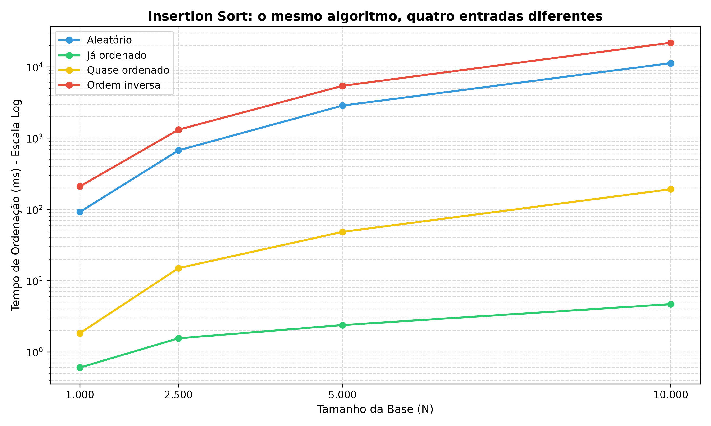
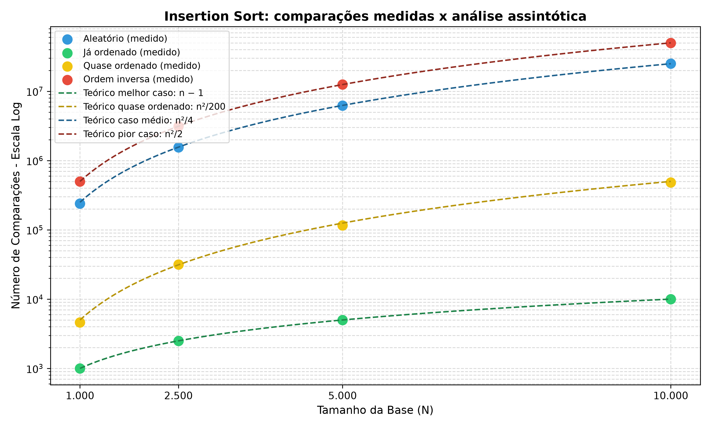
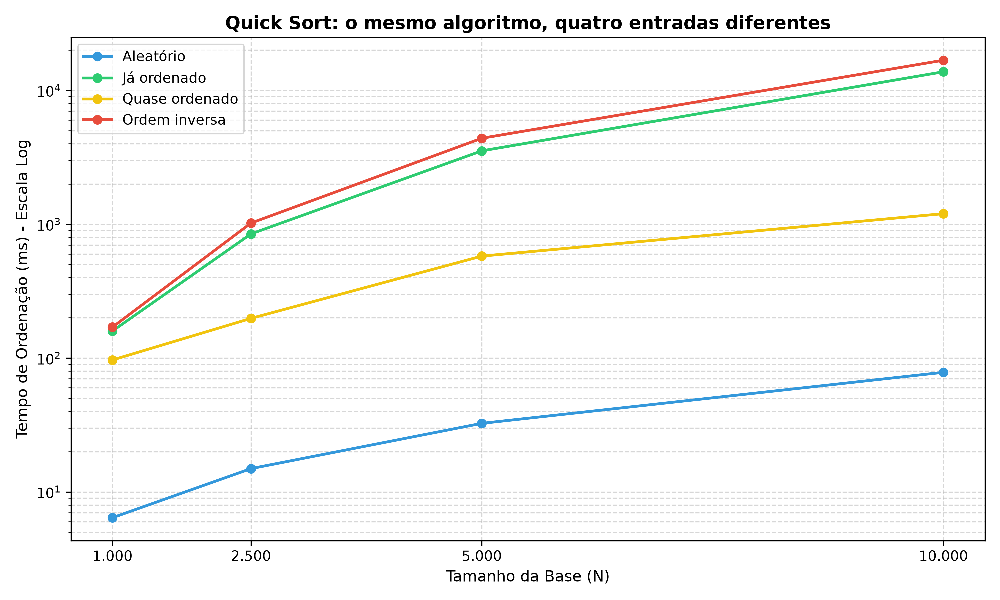
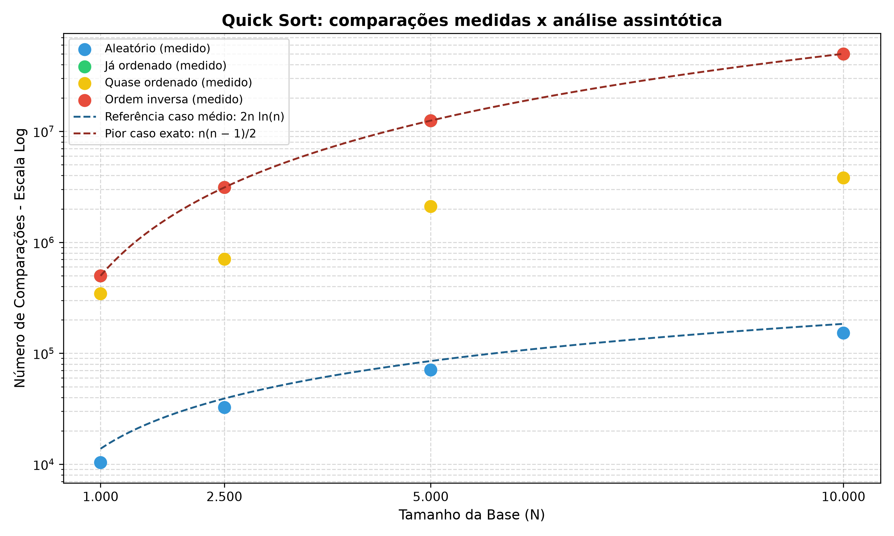
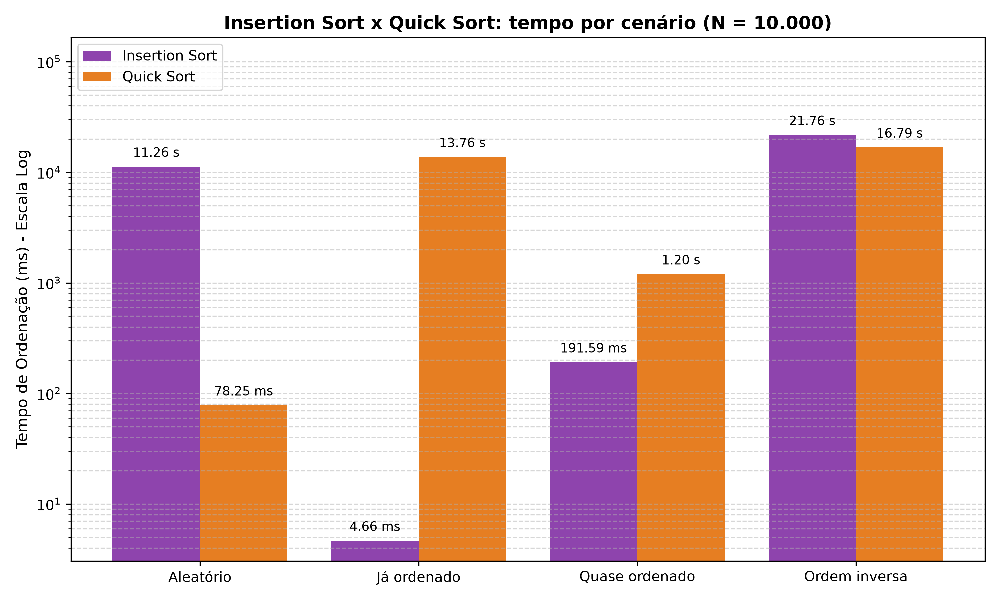

# Ordenação no Estoque

Projeto prático desenvolvido para a disciplina de **Estrutura de Dados II**. O sistema simula o estoque de uma rede de drogarias para avaliar, na prática e na teoria, como diferentes **métodos de ordenação** se comportam conforme a forma em que os dados chegam.

## Cenário

Nosso cliente é o dono de uma **rede de drogarias com várias filiais** (o mesmo do [trabalho de busca](https://github.com/eda2-2026/G28_Busca_EDA2-2026.2)). No trabalho anterior mostramos que a busca binária é centenas de vezes mais rápida que a sequencial — **mas ela exige o cadastro ordenado**. A pergunta agora é: *qual método usar para manter o estoque ordenado por código?*

A resposta não é única. Os dados chegam de formas muito diferentes no dia a dia:

| Cenário | Situação real na drogaria |
| :--- | :--- |
| **Aleatório** | carga inicial de um sistema novo / importação de outra filial |
| **Já ordenado** | reprocessamento de um estoque que já está em ordem |
| **Quase ordenado** | estoque ordenado + um **lote pequeno (1%)** de produtos novos cadastrado no fim (reposição diária) |
| **Ordem inversa** | relatório exportado em ordem decrescente |

O objetivo do trabalho é mostrar que **a escolha do método de ordenação precisa levar em conta o formato da entrada**: o mesmo algoritmo pode ser o melhor num cenário e o pior em outro.

## Objetivos

### MVP (essencial)

Comparar dois métodos de ordenação com comportamentos opostos:

1. **Insertion Sort** — $O(n)$ no melhor caso, $O(n^2)$ no médio e no pior caso.
2. **Quick Sort** (pivô = primeiro elemento) — $O(n \log n)$ no caso médio, degradando para $O(n^2)$ em entradas ordenadas.

- Ordenar a base de produtos por **código** nos quatro cenários acima.
- Medir **tempo**, **número de comparações** e **número de movimentações**.
- Experimentos com bases de $1.000$, $2.500$, $5.000$ e $10.000$ produtos.
- Gráficos de desempenho ($Tempo \times N$) e comparação com a análise assintótica.

### Extras

- Demonstração de **estabilidade** (ordenar por preço e depois por categoria).
- Testes automatizados de corretude.

## Tecnologias

- **Linguagem:** Python 3.10+
- **Biblioteca Externa:**
  - `matplotlib`: geração dos gráficos comparativos de desempenho.

## Estrutura
```text
├── assets/
│   ├── insertion_tempo_cenarios.png  # tempo x N do insertion nos 4 cenários
│   ├── insertion_comparacoes.png     # comparações medidas x curvas teóricas
│   ├── quick_tempo_cenarios.png      # tempo x N do quick nos 4 cenários
│   ├── quick_comparacoes.png         # comparações do quick x referências teóricas
│   ├── comparacao_cenarios.png       # tempo por cenário no maior N (todos os algoritmos)
│   └── ultimos_resultados.json       # dados da última execução do benchmark
│
├── src/
│   ├── __init__.py
│   ├── models.py                     # classe Produto e gerador de base aleatória
│   ├── cenarios.py                   # montagem dos 4 cenários de entrada
│   └── sorts/
│       ├── __init__.py               # registro dos algoritmos comparados
│       ├── base.py                   # contrato comum (Estatisticas)
│       ├── insertion.py              # insertion sort
│       └── quick.py                  # quick sort
│
├── .gitignore
├── comparacao.py                     # benchmark: algoritmos x cenários x tamanhos
├── main.py                           # demonstração dos dois algoritmos
├── plot_results.py                   # leitura do JSON e geração dos gráficos
├── testes.py                         # testes de corretude
├── requirements.txt                  # dependência: matplotlib
└── README.md
```

## Como rodar

```bash
# 1. criar e ativar o ambiente virtual (opcional, mas recomendado)
# no windows:
python -m venv venv
.\venv\Scripts\Activate.ps1

# no linux / macOS:
python3 -m venv venv
source venv/bin/activate

# 2. instalar dependências
python -m pip install -r requirements.txt

# 3. execução dos scripts
# demonstração (ordenação, estabilidade e custo por cenário)
python main.py

# testes de corretude
python testes.py

# benchmark (padrão: 1.000, 2.500, 5.000 e 10.000) — pode levar alguns minutos
python comparacao.py

# ou com tamanhos personalizados
python comparacao.py 500 2000 4000

# gerar os gráficos na pasta assets/ a partir do último benchmark
python plot_results.py
```

> **Por que não 100.000 produtos, como no trabalho de busca?** Nos casos quadráticos, aumentar a entrada de 10.000 para 100.000 pode aumentar o trabalho em cerca de 100 vezes. Por isso usamos os tamanhos previstos para este trabalho.

## Insertion Sort

### Funcionamento

A lista é dividida em uma parte **já ordenada** (à esquerda) e uma parte **ainda não processada** (à direita). A cada passo, o primeiro elemento não processado é retirado e **inserido na posição correta** da parte ordenada, deslocando uma casa para a direita todos os elementos maiores que ele — como quem organiza cartas de baralho na mão.

```text
[ 3 | 7 1 5 ]   -> 7 já está no lugar           (1 comparação)
[ 3 7 | 1 5 ]   -> 1 anda até o início           (2 comparações, 2 deslocamentos)
[ 1 3 7 | 5 ]   -> 5 passa pelo 7 e para no 3     (2 comparações, 1 deslocamento)
[ 1 3 5 7 ]
```

```python
for i in range(1, len(lista)):
    atual = lista[i]
    j = i - 1
    while j >= 0 and chave(lista[j]) > chave(atual):
        lista[j + 1] = lista[j]   # desloca o maior para a direita
        j -= 1
    lista[j + 1] = atual          # encaixa na posição livre
```

### Análise de complexidade

O trabalho do Insertion Sort é proporcional ao número de **inversões** da entrada (pares de elementos fora de ordem): cada deslocamento desfaz exatamente uma inversão.

| Caso | Entrada | Comparações | Complexidade |
| :--- | :--- | :--- | :--- |
| **Melhor** | já ordenada | $n - 1$ (cada elemento só olha o vizinho) | $O(n)$ |
| **Quase ordenado** | ordenada + lote de $n/100$ itens no fim | $\approx \frac{n}{100} \cdot \frac{n}{2} = \frac{n^2}{200}$ | $O(n \cdot k)$, com $k$ itens fora do lugar |
| **Médio** | aleatória | $\approx \frac{n^2}{4}$ (cada elemento anda metade da parte ordenada) | $O(n^2)$ |
| **Pior** | ordem inversa | $\frac{n(n-1)}{2}$ (cada elemento anda até o início) | $O(n^2)$ |

**Propriedades:**
- **Estável:** o laço só desloca elementos *estritamente maiores*, então produtos com chaves iguais mantêm a ordem original (ver `main.py`, demonstração 2).
- **In-place:** memória extra $O(1)$.
- **Online:** consegue ordenar à medida que os dados chegam — ideal para inserir produtos novos em um estoque já ordenado.

## Quick Sort

### Funcionamento

O Quick Sort usa **divisão e conquista**: escolhe um pivô, separa os elementos
em dois grupos e repete o processo em cada grupo. Nesta implementação, o pivô
é sempre o **primeiro elemento do intervalo**. A partição coloca os menores
à esquerda e os maiores ou iguais à direita; depois posiciona o pivô em seu
lugar definitivo.

```text
[ 3 7 1 5 ]   -> pivô = 3; compara 7, 1 e 5 com o pivô
[ 3 1 7 5 ]   -> troca 1 com 7, levando o menor para a esquerda
[ 1 | 3 | 7 5 ] -> coloca o pivô 3 na posição definitiva
[ 1 | 3 | 5 7 ] -> ordena o lado direito usando 7 como pivô
[ 1 3 5 7 ]
```

Neste exemplo, são **4 comparações e 6 movimentações**: três comparações na
primeira partição, uma na segunda e três trocas efetivas.

### Análise de complexidade

| Caso | Entrada / divisão | Comparações | Complexidade |
| :--- | :--- | :--- | :--- |
| **Melhor** | pivôs dividem os intervalos em partes equilibradas | ordem de $n \log n$ | $O(n \log n)$ |
| **Médio** | ordem aleatória, com chaves distintas | ordem de $n \log n$, em média | $O(n \log n)$ |
| **Pior** | já ordenada, inversa ou com todas as chaves iguais | $\frac{n(n-1)}{2}$ | $O(n^2)$ |

Com divisões equilibradas, há cerca de $\log n$ níveis, cada um com trabalho
total $O(n)$. Quando o pivô é sempre um extremo, um lado fica vazio e o outro
tem apenas um elemento a menos: $(n-1) + (n-2) + \cdots + 1$ comparações.
Para **10.000 produtos ordenados**, isso resulta em **49.995.000 comparações**.
No cenário quase ordenado, o resultado depende da posição dos códigos do lote
novo; ele também pode gerar divisões desequilibradas e mantém pior caso $O(n^2)$.

**Propriedades:**

- **Não estável:** as trocas podem inverter a ordem de produtos com chaves
  iguais. Por exemplo, `[2, 1A, 1B]` termina como `[1B, 1A, 2]`.
- **Ordena na própria lista:** não cria listas auxiliares para as partições.
  A pilha de intervalos usa memória auxiliar $O(\log n)$, pois o menor lado é
  processado primeiro e o maior fica pendente.
- **Sem recursão Python:** a pilha explícita evita `RecursionError`, mas não
  elimina o tempo quadrático causado pela escolha do primeiro pivô.

## Resultados e gráficos

O fluxo é **comparacao.py → assets/ultimos_resultados.json → plot_results.py**.
Para cada tamanho, uma base é gerada com a sequência aleatória inicializada com
semente 42. Os dois algoritmos recebem cópias da mesma entrada em cada cenário.
Cada medição usa três repetições da mesma entrada: o JSON guarda a mediana do
tempo em **milissegundos** e as contagens de comparações e movimentações.
Geração, cópia e validação ficam fora do cronômetro; a instrumentação é incluída.

Os caminhos são baseados na pasta dos scripts. Para redesenhar os gráficos sem
repetir o benchmark, execute somente `python plot_results.py`. Executar um
benchmark menor substitui o JSON; rode o gerador depois para manter as imagens
consistentes. Para retornar aos tamanhos completos, execute os dois scripts sem
argumentos. Os tempos variam conforme o computador.

### Insertion Sort





### Quick Sort





Os dois algoritmos usam o mesmo estilo, as mesmas cores para os cenários e escala
logarítmica no eixo vertical. No Quick, a curva `2n ln(n)` é uma referência
assintótica para o caso médio com códigos distintos, não uma previsão exata.
A curva `n(n−1)/2` representa exatamente as comparações do pior caso. Os pontos
ordenado e inverso podem ficar sobrepostos porque possuem a mesma contagem.

### Comparação entre algoritmos



Todas as figuras acima são geradas a partir do [mesmo JSON](assets/ultimos_resultados.json).
Os tempos variam conforme o computador. Para comparar os métodos, use medições
da mesma execução, sem misturar os resultados antigos de máquinas diferentes.

### Análise dos resultados publicados

Medianas para **10.000 produtos**, em milissegundos:

| Cenário | Insertion Sort | Quick Sort |
| :--- | ---: | ---: |
| Aleatório | 11263.02 | 78.25 |
| Já ordenado | 4.66 | 13761.44 |
| Quase ordenado | 191.59 | 1198.37 |
| Ordem inversa | 21761.36 | 16791.00 |

- **Aleatório:** Quick Sort foi mais rápido, coerente com seu comportamento
  médio de O(n log n), enquanto Insertion apresenta comportamento médio quadrático.
- **Ordenado:** Insertion fez 9.999 comparações; Quick fez 49.995.000, pois o
  primeiro pivô provoca divisões desequilibradas.
- **Quase ordenado:** Insertion foi mais rápido nesta execução. O lote de 1%
  cresce com N, portanto esse cenário não garante complexidade linear.
- **Inverso:** ambos fizeram 49.995.000 comparações. Quick foi mais rápido nesta
  execução, mas ambos permanecem quadráticos; contagens de movimentações diferentes
  ajudam a explicar por que a mesma classe assintótica não implica tempos iguais.

## Resultados e análise experimental

Tempo = mediana de 3 execuções; comparações contadas pelo próprio algoritmo.
Todas as tabelas abaixo usam os dados atuais de `assets/ultimos_resultados.json`,
os mesmos usados nos gráficos. Em cada cenário, os métodos receberam cópias da
mesma entrada. Os tempos são específicos desta execução e deste computador.

### 1. Insertion Sort — tempo (ms)

| Tamanho (N) | Aleatório | Já ordenado | Quase ordenado | Ordem inversa |
| :--- | ---: | ---: | ---: | ---: |
| **1.000** | 92,04 ms | 0,60 ms | 1,83 ms | 209,89 ms |
| **2.500** | 671,12 ms | 1,55 ms | 14,93 ms | 1.310,37 ms |
| **5.000** | 2.858,74 ms | 2,37 ms | 48,28 ms | 5.413,62 ms |
| **10.000** | 11.263,02 ms | 4,66 ms | 191,59 ms | 21.761,36 ms |

### 2. Insertion Sort — comparações (medido x teórico)

| Tamanho (N) | Já ordenado <br> (exato $n-1$) | Quase ordenado <br> (aproximação $n^2/200$) | Aleatório <br> (aproximação $n^2/4$) | Ordem inversa <br> (exato $n(n-1)/2$) |
| :--- | ---: | ---: | ---: | ---: |
| **1.000** | 999 <br> (999) | 4.605 <br> (5.000) | 240.281 <br> (250.000) | 499.500 <br> (499.500) |
| **2.500** | 2.499 <br> (2.499) | 31.526 <br> (31.250) | 1.555.129 <br> (1.562.500) | 3.123.750 <br> (3.123.750) |
| **5.000** | 4.999 <br> (4.999) | 115.864 <br> (125.000) | 6.232.901 <br> (6.250.000) | 12.497.500 <br> (12.497.500) |
| **10.000** | 9.999 <br> (9.999) | 482.871 <br> (500.000) | 25.044.708 <br> (25.000.000) | 49.995.000 <br> (49.995.000) |

Ordenado e inverso coincidem exatamente com as fórmulas. Aleatório e quase
ordenado são aproximações: variam com a base sorteada, especialmente com a
posição dos códigos do lote novo.

### 3. Gráficos do Insertion Sort


### 4. Análise do Insertion Sort

* **A ordem da entrada muda muito o custo.** Com 10.000 produtos, a entrada ordenada levou **4,66 ms**, contra **21,76 s** na inversa: cerca de **4.667 vezes** mais tempo.

* **O crescimento é coerente com a análise assintótica.** De 5.000 para 10.000 produtos, o tempo aleatório cresceu **3,94×** e o ordenado, **1,96×**, ilustrando os comportamentos quadrático e linear.

* **O ponto forte é a reposição diária.** No cenário quase ordenado, 10.000 produtos levaram **191,59 ms**, cerca de **59× menos tempo** que a entrada aleatória. Poucas inversões reduzem o trabalho; com lote proporcional a N, isso não garante tempo linear.

* **O ponto fraco é a carga desorganizada.** Nas entradas aleatória e inversa, o custo é quadrático. O Quick com primeiro pivô ajuda na aleatória, mas também tem pior caso quadrático na inversa.

### 5. Quick Sort — tempo (ms)

| Tamanho (N) | Aleatório | Já ordenado | Quase ordenado | Ordem inversa |
| :--- | ---: | ---: | ---: | ---: |
| **1.000** | 6,42 ms | 159,33 ms | 96,78 ms | 170,23 ms |
| **2.500** | 14,93 ms | 846,28 ms | 197,90 ms | 1.019,70 ms |
| **5.000** | 32,53 ms | 3.531,94 ms | 577,56 ms | 4.386,65 ms |
| **10.000** | 78,25 ms | 13.761,44 ms | 1.198,37 ms | 16.791,00 ms |

### 6. Quick Sort — comparações (medido x teórico)

| Tamanho (N) | Aleatório <br> (referência $2n\ln(n)$) | Já ordenado <br> (exato $n(n-1)/2$) | Quase ordenado <br> (medido) | Ordem inversa <br> (exato $n(n-1)/2$) |
| :--- | ---: | ---: | ---: | ---: |
| **1.000** | 10.382 <br> (≈ 13.816) | 499.500 <br> (499.500) | 344.716 | 499.500 <br> (499.500) |
| **2.500** | 32.521 <br> (≈ 39.120) | 3.123.750 <br> (3.123.750) | 704.798 | 3.123.750 <br> (3.123.750) |
| **5.000** | 71.005 <br> (≈ 85.172) | 12.497.500 <br> (12.497.500) | 2.112.963 | 12.497.500 <br> (12.497.500) |
| **10.000** | 152.281 <br> (≈ 184.207) | 49.995.000 <br> (49.995.000) | 3.821.815 | 49.995.000 <br> (49.995.000) |

A referência $2n\ln(n)$ mostra o termo dominante do caso médio com chaves distintas,
não uma contagem exata. Ordenado e inverso atingem exatamente o pior caso.
No quase ordenado, as divisões dependem dos códigos do lote; não há uma fórmula
exata determinada apenas por N e pela proporção de 1%.

### 7. Gráficos do Quick Sort


As cores e a escala logarítmica seguem o padrão do Insertion. Os pontos dos
cenários ordenado e inverso ficam sobrepostos no gráfico de comparações.

### 8. Análise do Quick Sort

* **O ponto forte é a entrada aleatória.** Para 10.000 produtos, levou **78,25 ms**, contra **11.263,02 ms** do Insertion: cerca de **144× menos tempo** nesta execução. Foram **152.281 comparações**, coerentes com o comportamento médio $O(n\log n)$.

* **O primeiro pivô prejudica entradas ordenadas.** O mesmo tamanho já ordenado levou **13,76 s** e **49.995.000 comparações**. Cada partição deixa um lado vazio e outro com apenas um elemento a menos, produzindo $O(n^2)$.

* **A entrada quase ordenada também pode gerar divisões desequilibradas.** Foram **3.821.815 comparações** e **1.198,37 ms**, contra **191,59 ms** do Insertion. O lote pequeno não garante bom desempenho para esta escolha de pivô.

* **Na inversa, o Quick também é quadrático.** De 5.000 para 10.000 produtos, o tempo cresceu **3,83×**. Para 10.000 produtos foram **49.995.000 comparações**, assim como no Insertion. O Quick fez **10.000 movimentações**, contra **50.004.999** do Insertion; isso ajuda a explicar tempos diferentes dentro da mesma classe assintótica.

### 9. Recomendação para o cliente


Para a reposição diária ou o estoque já ordenado, **Insertion Sort** foi a melhor
opção nesta execução. Para uma carga inicial aleatória, **Quick Sort** apresentou
vantagem. Em entradas inversas, ambos são quadráticos: a versão de Quick com
primeiro pivô não deve ser apresentada como uma solução eficiente para todos
os formatos. Uma escolha de pivô aleatória ou mediana de três pode ser estudada
como melhoria futura, mas não faz parte desta implementação.

## Integrantes

| Nome | GitHub |
|---|---|
| Enzo Lopes | [@lopes061](https://github.com/lopes061) |
| Luan Vinícius | [@luannvi](https://github.com/luannvi) |

## Vídeo de Apresentação

[](LINK_DO_SEU_VIDEO_AQUI)
