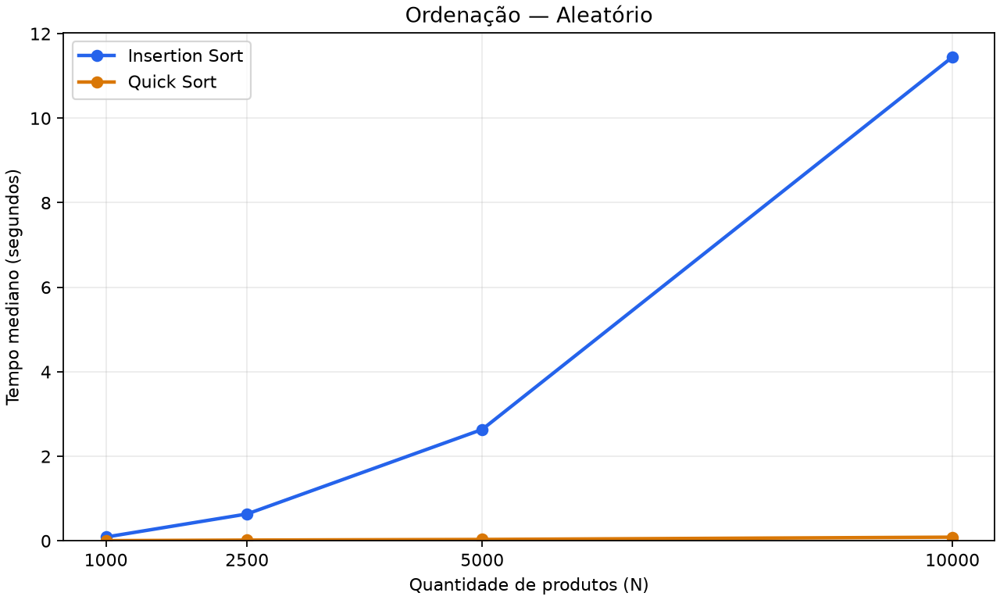
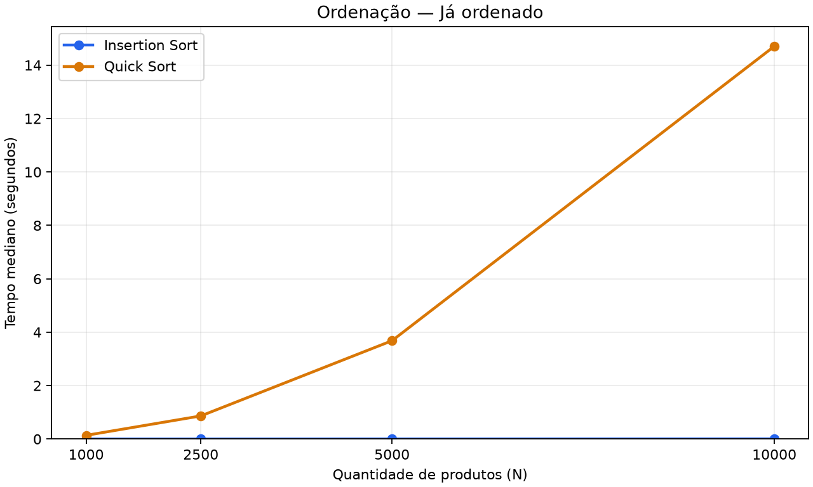
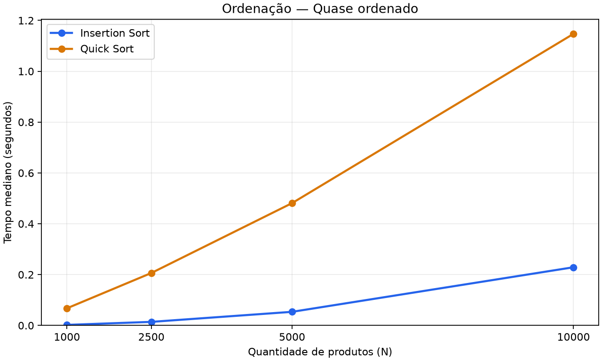
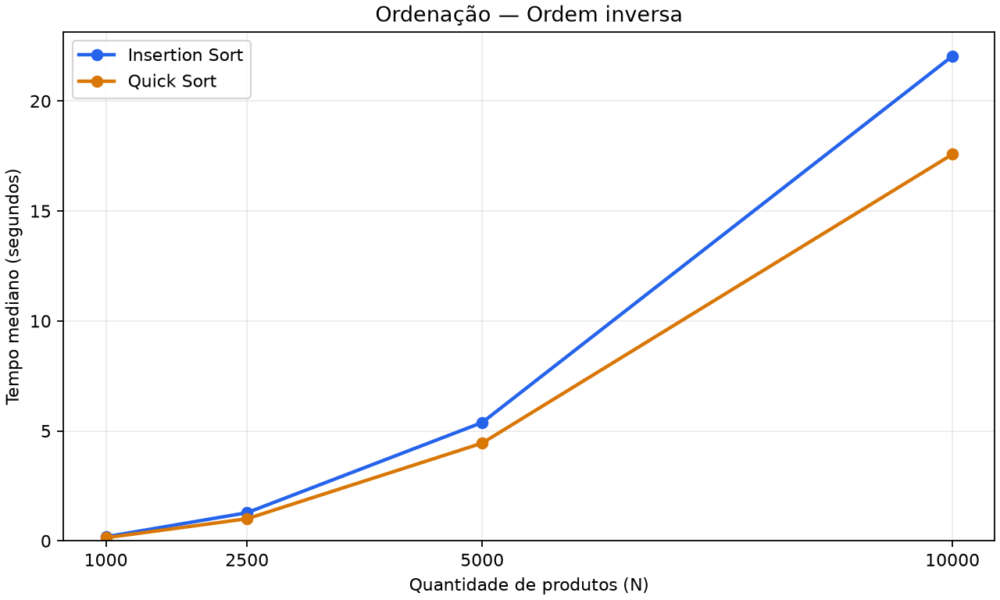

# Ordenação no Estoque

Projeto prático desenvolvido para a disciplina de **Estrutura de Dados II**. O sistema simula o estoque de uma rede de drogarias para avaliar, na prática e na teoria, como diferentes **métodos de ordenação** se comportam conforme a forma em que os dados chegam.

## Cenário

Nosso cliente é o dono de uma **rede de drogarias com várias filiais** (o mesmo do [trabalho de busca](https://github.com/eda2-2026/G28_Busca_EDA2-2026.2)). No trabalho anterior mostramos que a busca binária é centenas de vezes mais rápida que a sequencial — **mas ela exige o cadastro ordenado**. A pergunta agora é: *qual método usar para manter o estoque ordenado por código?*

A resposta não é única. Os dados chegam de formas muito diferentes no dia a dia:

| Cenário | Situação real na drogaria |
| :--- | :--- |
| **Aleatório** | carga inicial de um sistema novo / importação de outra filial |
| **Já ordenado** | reprocessamento de um estoque que já está em ordem |
| **Quase ordenado** | estoque ordenado + um **lote pequeno (1%)** de produtos novos cadastrado no fim (reposição diária) |
| **Ordem inversa** | relatório exportado em ordem decrescente |

O objetivo do trabalho é mostrar que **a escolha do método de ordenação precisa levar em conta o formato da entrada**: o mesmo algoritmo pode ser o melhor num cenário e o pior em outro.

## Objetivos

### MVP (essencial)

Comparar dois métodos de ordenação com comportamentos opostos:

1. **Insertion Sort** — $O(n)$ no melhor caso, $O(n^2)$ no médio e no pior caso.
2. **Quick Sort** (pivô = primeiro elemento) — $O(n \log n)$ no caso médio, degradando para $O(n^2)$ em entradas ordenadas.

- Ordenar a base de produtos por **código** nos quatro cenários acima.
- Medir **tempo**, **número de comparações** e **número de movimentações**.
- Experimentos com bases de $1.000$, $2.500$, $5.000$ e $10.000$ produtos.
- Gráficos de desempenho ($Tempo \times N$) e comparação com a análise assintótica.

### Extras

- Demonstração de **estabilidade** (ordenar por preço e depois por categoria).
- Testes automatizados de corretude.

## Tecnologias

- **Linguagem:** Python 3.10+
- **Biblioteca Externa:**
  - `matplotlib`: geração dos gráficos comparativos de desempenho.

## Insertion Sort

### Funcionamento

A lista é dividida em uma parte **já ordenada** (à esquerda) e uma parte **ainda não processada** (à direita). A cada passo, o primeiro elemento não processado é retirado e **inserido na posição correta** da parte ordenada, deslocando uma casa para a direita todos os elementos maiores que ele — como quem organiza cartas de baralho na mão.

```text
[ 3 | 7 1 5 ]   -> 7 já está no lugar           (1 comparação)
[ 3 7 | 1 5 ]   -> 1 anda até o início           (2 comparações, 2 deslocamentos)
[ 1 3 7 | 5 ]   -> 5 passa pelo 7 e para no 3     (2 comparações, 1 deslocamento)
[ 1 3 5 7 ]
```

```python
for i in range(1, len(lista)):
    atual = lista[i]
    j = i - 1
    while j >= 0 and chave(lista[j]) > chave(atual):
        lista[j + 1] = lista[j]   # desloca o maior para a direita
        j -= 1
    lista[j + 1] = atual          # encaixa na posição livre
```

### Análise de complexidade

O trabalho do Insertion Sort é proporcional ao número de **inversões** da entrada (pares de elementos fora de ordem): cada deslocamento desfaz exatamente uma inversão.

| Caso | Entrada | Comparações | Complexidade |
| :--- | :--- | :--- | :--- |
| **Melhor** | já ordenada | $n - 1$ (cada elemento só olha o vizinho) | $O(n)$ |
| **Quase ordenado** | ordenada + lote de $n/100$ itens no fim | $\approx \frac{n}{100} \cdot \frac{n}{2} = \frac{n^2}{200}$ | $O(n \cdot k)$, com $k$ itens fora do lugar |
| **Médio** | aleatória | $\approx \frac{n^2}{4}$ (cada elemento anda metade da parte ordenada) | $O(n^2)$ |
| **Pior** | ordem inversa | $\frac{n(n-1)}{2}$ (cada elemento anda até o início) | $O(n^2)$ |

**Propriedades:**
- **Estável:** o laço só desloca elementos *estritamente maiores*, então produtos com chaves iguais mantêm a ordem original (ver `main.py`, demonstração 2).
- **In-place:** memória extra $O(1)$.
- **Online:** consegue ordenar à medida que os dados chegam — ideal para inserir produtos novos em um estoque já ordenado.

## Quick Sort

### Funcionamento

O Quick Sort usa **divisão e conquista**: escolhe um pivô, separa os elementos
em dois grupos e repete o processo em cada grupo. Nesta implementação, o pivô
é sempre o **primeiro elemento do intervalo**. A partição coloca os menores
à esquerda e os maiores ou iguais à direita; depois posiciona o pivô em seu
lugar definitivo.

```text
[ 3 7 1 5 ]   -> pivô = 3; compara 7, 1 e 5 com o pivô
[ 3 1 7 5 ]   -> troca 1 com 7, levando o menor para a esquerda
[ 1 | 3 | 7 5 ] -> coloca o pivô 3 na posição definitiva
[ 1 | 3 | 5 7 ] -> ordena o lado direito usando 7 como pivô
[ 1 3 5 7 ]
```

Neste exemplo, são **4 comparações e 6 movimentações**: três comparações na
primeira partição, uma na segunda e três trocas efetivas.

### Análise de complexidade

| Caso | Entrada / divisão | Comparações | Complexidade |
| :--- | :--- | :--- | :--- |
| **Melhor** | pivôs dividem os intervalos em partes equilibradas | ordem de $n \log n$ | $O(n \log n)$ |
| **Médio** | ordem aleatória, com chaves distintas | ordem de $n \log n$, em média | $O(n \log n)$ |
| **Pior** | já ordenada, inversa ou com todas as chaves iguais | $\frac{n(n-1)}{2}$ | $O(n^2)$ |

Com divisões equilibradas, há cerca de $\log n$ níveis, cada um com trabalho
total $O(n)$. Quando o pivô é sempre um extremo, um lado fica vazio e o outro
tem apenas um elemento a menos: $(n-1) + (n-2) + \cdots + 1$ comparações.
Para **10.000 produtos ordenados**, isso resulta em **49.995.000 comparações**.
No cenário quase ordenado, o resultado depende da posição dos códigos do lote
novo; ele também pode gerar divisões desequilibradas e mantém pior caso $O(n^2)$.

**Propriedades:**

- **Não estável:** as trocas podem inverter a ordem de produtos com chaves
  iguais. Por exemplo, `[2, 1A, 1B]` termina como `[1B, 1A, 2]`.
- **Ordena na própria lista:** não cria listas auxiliares para as partições.
  A pilha de intervalos usa memória auxiliar $O(\log n)$, pois o menor lado é
  processado primeiro e o maior fica pendente.
- **Sem recursão Python:** a pilha explícita evita `RecursionError`, mas não
  elimina o tempo quadrático causado pela escolha do primeiro pivô.

## Execução e gráficos

```bash
# cria um ambiente virtual para instalar as dependências do projeto
python -m venv venv

# ativa o ambiente virtual no PowerShell do Windows
.\venv\Scripts\Activate.ps1

# instala as bibliotecas necessárias, listadas em requirements.txt
python -m pip install -r requirements.txt

# executa as demonstrações de ordenação, estabilidade e comparação dos algoritmos
python main.py

# executa os testes automatizados de corretude e contagem de operações
python testes.py

# executa os experimentos e salva o CSV e os quatro gráficos em resultados/
# pode levar alguns minutos, principalmente para 10.000 produtos
# substitui os arquivos de resultados de uma execução anterior
python comparacao.py
```

`main.py` é a demonstração e comparação das ordenações. `testes.py` verificam os dois algoritmos nos quatro cenários, entradas triviais e repetidas, estabilidade do Insertion,
contagens de operações e Quick Sort com 10.000 produtos ordenados. `comparacao.py` gera **quatro
gráficos de tempo**, um por cenário, e **um CSV** com as medianas de tempo,
comparações e movimentações dos dois algoritmos.

São usados 1.000, 2.500, 5.000 e 10.000 produtos, três repetições e semente 42.
Cada repetição gera uma nova base; os dois algoritmos recebem cópias da mesma
entrada. A ordem dos métodos é alternada. Geração, cópia e validação ficam fora
do cronômetro; a contagem de operações faz parte do tempo medido.

Para uma execução menor, altere `TAMANHOS` e `REPETICOES` no final de
`comparacao.py`. A execução completa pode levar alguns minutos e substitui
os arquivos em `resultados/`. Os resultados incluídos usam os valores padrão.

```text
resultados/
    resumo.csv
    graficos/
        tempo_aleatorio.png
        tempo_ordenado.png
        tempo_quase_ordenado.png
        tempo_inverso.png
```

Os tempos são medianas de três execuções locais e variam conforme o computador.
Os gráficos usam escala linear, com escala vertical própria para cada cenário.

### Gráficos de tempo

#### Entrada aleatória



#### Entrada já ordenada



#### Entrada quase ordenada



#### Entrada inversa



Consulte as [medianas de tempo e operações](resultados/resumo.csv).

### Análise dos resultados registrados

Medianas de tempo para **10.000 produtos**, em segundos:

| Cenário | Insertion Sort | Quick Sort |
| :--- | ---: | ---: |
| Aleatório | 10.394101 | 0.089705 |
| Já ordenado | 0.005703 | 14.680380 |
| Quase ordenado | 0.205022 | 1.132010 |
| Ordem inversa | 21.004516 | 16.840090 |

- **Aleatório:** Quick Sort foi mais rápido; as medianas foram 156.098
  comparações no Quick e 24.924.586 no Insertion, coerentes com seus comportamentos médios.
- **Ordenado:** Insertion fez 9.999 comparações, contra 49.995.000 no Quick.
  O primeiro pivô explica as partições desequilibradas e o pior caso do Quick.
- **Quase ordenado:** Insertion foi mais rápido nesta base, com 507.814
  comparações contra 3.650.095 no Quick. Um lote fixado em 1% cresce com N;
  esse cenário não garante tempo linear ao Insertion.
- **Inverso:** ambos fizeram 49.995.000 comparações. O Quick foi mais rápido
  nesta execução, mas ambos permanecem quadráticos. O Insertion fez 50.004.999
  movimentações e o Quick, 10.000; a mesma classe assintótica não implica tempos iguais.

Essas medições ilustram o comportamento; a análise assintótica vem do algoritmo,
não apenas de quatro pontos no gráfico. Outras cargas de trabalho do computador
podem alterar os tempos. O CSV registra a mediana de cada métrica das três repetições.

## Integrantes

| Nome | GitHub |
|---|---|
| Enzo Lopes | [@lopes061](https://github.com/lopes061) |
| Luan Vinícius | [@luannvi](https://github.com/luannvi) |

## Vídeo de Apresentação

[](LINK_DO_SEU_VIDEO_AQUI)
